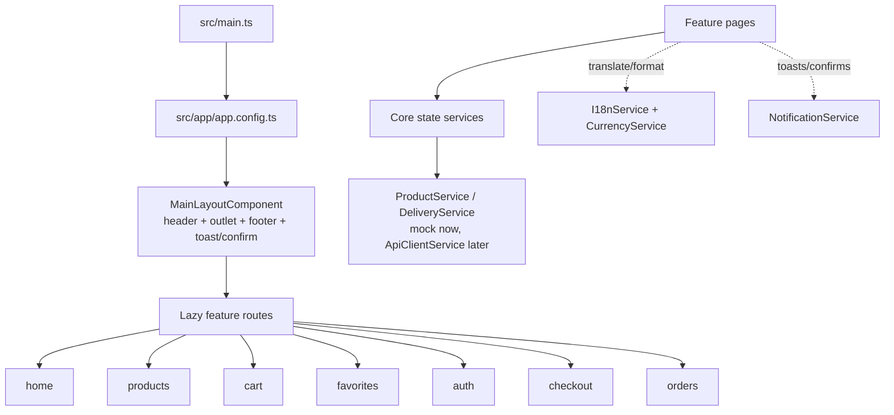

# Architecture

## Bootstrap

`src/main.ts` bootstraps the standalone `App` (`src/app/app.ts`, a bare
`<router-outlet />`) with `appConfig` (`src/app/app.config.ts`): Zone.js
change detection, router (with component-input binding), `HttpClient` with the
central `apiInterceptor`, async animations, PrimeNG Aura theme + ripple, and
the global `MessageService` / `ConfirmationService`. The `MainLayoutComponent`
(`src/app/layout/`) hosts the header, `<router-outlet>`, footer, and the
global `<p-toast>` / `<p-confirmDialog>` hosts. A custom
`LocalizedTitleStrategy` resolves per-route `data.titleKey` against the active
language for document titles.

## Routing

Lazy-loaded per feature (`src/app/app.routes.ts` → `features/*/*.routes.ts`).
Account-required routes (`favorites`, `orders`, `checkout`) carry
`canActivate: [authGuard]`; the guard stores a typed return intent and sends
guests to `/auth/login?returnUrl=…`. The product route (`products/:id`) reuses
one component instance across products — data reloads through a cancellable
`switchMap` pipeline, scroll resets via `ScrollService`. Intentionally there
is **no router-level scroll restoration**: catalog filter/search navigations
must not yank the viewport (see `ScrollService`).

## Features and shared code

- `features/*/` — one folder per customer journey, each with
  `*.component.ts/.html/.scss`, `*.routes.ts`, and specs where behavior
  warrants it. Pages own presentation + user intent, never HTTP.
- `shared/components/` — `ProductCard`, `EmptyState`, `SectionHeader`,
  `QtySelector` (all OnPush, external files).
- `shared/pipes/` — `MoneyPipe` (impure by design: re-formats on every
  change-detection pass using cached `Intl` formatters).
- `shared/utils/` — `validators`, `localized.utils` (`pickLocaleText`),
  `order-status.utils`.
- `layout/` — header (search + suggestions, language/currency selectors,
  badges, account menu, mobile drawer), footer, main layout.

## Dependency injection and state

All state services are root-provided singletons — exactly one instance per
service (verified: badge/page/checkout agreement depends on this; never
re-provide them in components). Ownership:

| State | Owner | Consumers derive via |
|---|---|---|
| Cart lines (raw) | `CartStore` | `CartViewService.lines` (enriched join) |
| Favorites ids | `FavoritesStore` | `ids()` / `count()` directly |
| Session | `AuthService` | `user()` / `isLoggedIn()` |
| Pending shopping intent | `PendingActionService` | `peek()` / `consume()` (exactly-once) |
| Products/categories (mock) | `ProductService` signals | `list()`, `all()`, `categories()` |
| Hotels/quotes (mock) | `DeliveryService` | `hotels()`, `quoteFor()` |
| Language/dir | `I18nService` | `currentLang()` / `t()` in templates |
| Currency | `CurrencyService` | `code()` / `format()` |

Signals hold client state; RxJS (`Observable` + `switchMap`, `debounceTime`,
`takeUntilDestroyed` where subscriptions exist) carries async flows.
Components are `OnPush` throughout; impure pipes and signal reads keep views
fresh without manual subscriptions.

## Error handling

`apiInterceptor` maps HTTP failures to localized toasts centrally. Mock
services fail loudly (`throwError`) so pages can render explicit
loading / ready / not-found / error states — a request must always reach a
terminal UI state, never a permanent skeleton. Local-storage parsing is
defensive (invalid data is skipped item-by-item, never crashes).

## Mock-data boundaries (what is fake today)

- `src/app/data-access/mock-data.ts` — products, categories.
- `DeliveryService.HOTELS` — sample hotels/fees (labeled SAMPLE).
- `AuthService` / `OrderService` — localStorage-backed, development-only.
- Components never import mock data directly (except the catalog filter,
  which was migrated to `ProductService.categories()`).

## Future API boundaries (proposed, not built)

`ApiClientService` + `apiInterceptor` (base URL, auth header, error mapping)
are the only HTTP touchpoints. `DeliveryService.quoteFor`,
`ProductService.*`, `OrderService.create`, cart/favorites sync and
`store/settings` map 1:1 to [API Contract](./API_CONTRACT.md) endpoints.
Details: [API Integration](./API_INTEGRATION.md).
