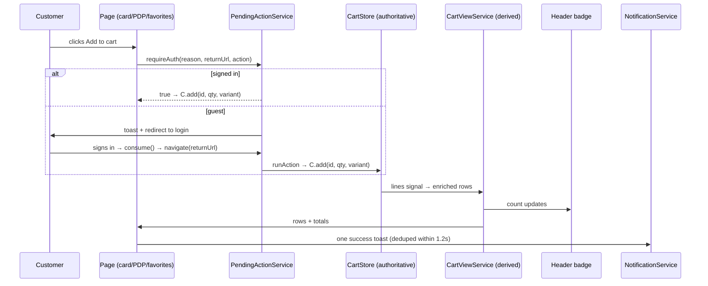

# State Management

## Ownership map

| Domain | Owner (`src/app/core/services/`) | Public API | Persists to |
|---|---|---|---|
| Cart lines (raw) | `cart.store.ts` (`CartStore`) | `lines`, `count`, `isEmpty`, `add/setQty/remove/clear/qtyOf` | `localStorage: novamart.cart.v1` |
| Cart display rows | `cart-view.service.ts` (`CartViewService`) | `lines` (enriched), `pricedSubtotal`, `unavailableCount`, `ready/failed`, `refresh()` | — (derived) |
| Favorites | `favorites.store.ts` | `ids`, `count`, `has/add/remove/toggle/clear` | `localStorage: novamart.favorites.v1` |
| Session | `auth.service.ts` (mock) | `user`, `isLoggedIn`, `login/register/logout/requestPasswordReset` | `novamart.session.v1`, `novamart.mock-users.v1` |
| Pending intent | `pending-action.service.ts` | `request/peek/consume/clear`, `requireAuth`, `runAction`, `explain` | in-memory only (refresh clears) |
| Products/categories | `product.service.ts` (mock) | `list/all/getById/related/categories/categoryName/...` | — |
| Hotels/quotes | `delivery.service.ts` (mock) | `hotels/cities/hotelById/search/quoteFor` | — |
| Language/dir | `i18n.service.ts` | `currentLang`, `dir`, `t()`, `setLang` | `localStorage: novamart.lang` |
| Currency | `currency.service.ts` | `code`, `format`, `formatDate`, `setCurrency` | `localStorage: novamart.currency` |
| Orders | `order.service.ts` (mock) | `list/getById/create` (idempotent) | `localStorage: novamart.orders.v1` |
| Recent views | `recently-viewed.service.ts` | `push/list` | `localStorage: novamart.recently-viewed.v1` |

## Cart conventions (binding)

- **Identity**: one line per `productId + variantKey`
  (`cartLineKey()` in `models/cart.model.ts`). Same product + same variant →
  quantity grows on that line; different variant → separate line; different
  products never merge (names/descriptions are not identity).
- **Badge**: `cartCount = Σ qty` over **all** lines, including unavailable
  ones — and the cart page renders an explicit row per line, so both agree.
- **Money**: only available lines contribute (`CartViewService.pricedSubtotal`).
- **Clamping**: quantities clamp to `[1, stock]` (store) and `[1, 99]` persisted.
- **Hydration**: `load()` validates item-by-item; unknown ids stay as
  *unavailable rows* (removable, priced 0) — never silently dropped, never
  crash. Hydration cannot overwrite newer actions: load runs once at store
  construction; every mutation persists synchronously after updating.
- **Future sync**: `CartStore` is the seam — server sync merges into
  `lines()`; view/totals/badge follow automatically. See `API_INTEGRATION.md`.

## Pending actions (exactly-once)

`request()` stores `{ returnUrl (validated), reason, action? }`;
`consume()` returns-and-clears atomically; login/register call
`consume()` → navigate → `runAction()` (re-resolves the product for live
stock). `safeReturnUrl()` rejects external URLs and `/auth/*` loops.

## Add-to-cart sequence

